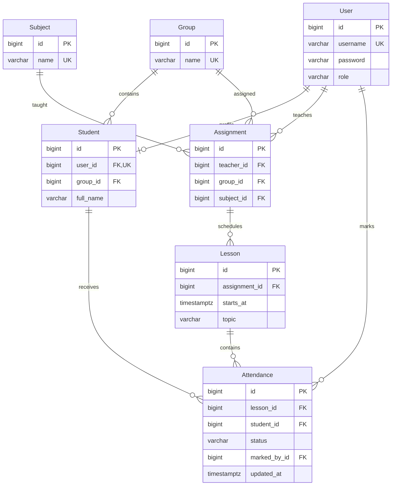

# Модель данных

Таблицы имеют префикс `journal_`. В User также используются стандартные поля AbstractUser (имя, фамилия, email, служебные флаги, last_login, date_joined). Технические таблицы Django для сессий, групп разрешений, типов содержимого и миграций на предметной схеме опущены.

Уникальны username, имя группы, название дисциплины, user_id профиля, тройка teacher/group/subject, пара assignment/starts_at и пара lesson/student. Для статуса посещения действует CHECK. Типы PK предметных таблиц — bigint. Точные типы и ограничения отражены в SQL миграции.

Внешние ключи обеспечивают наличие связанных записей. Правило «студент принадлежит группе занятия» проверяется сервером. Смена группы после отметок и изменение назначения после создания занятий блокируются. Связанные справочники защищены PROTECT на уровне Django; удаление занятия удаляет отметки CASCADE через ORM внутри транзакции. Не выполняйте прямые записи SQL в обход правил приложения.
